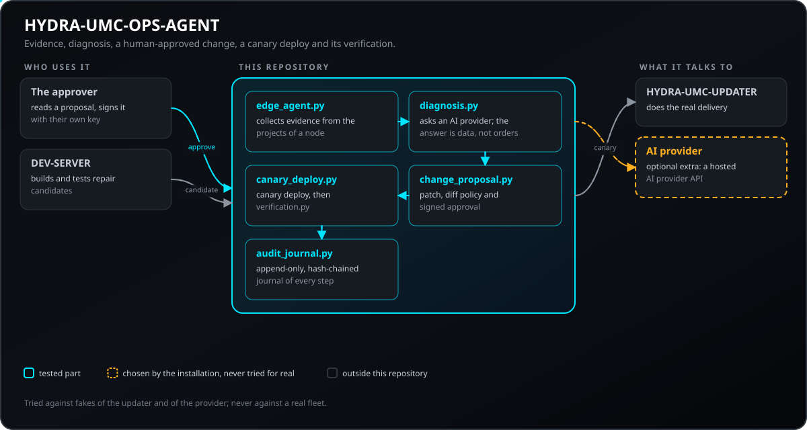
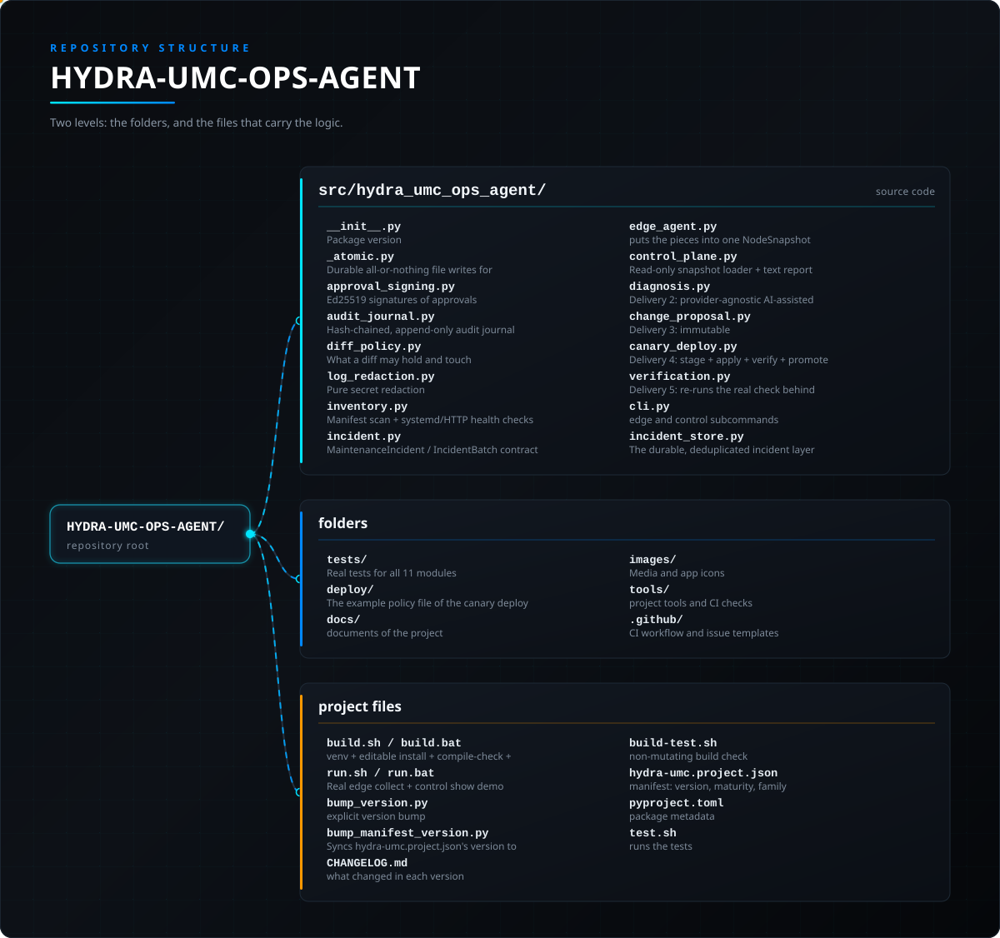

<!-- =============================================================================
HYDRA-UMC-OPS-AGENT - Maintenance-incident coordinator
Copyright (C) JuanenRac (Electro Hobby 3D) <electrohobby3d@gmail.com>
GPL-3.0-or-later - see LICENSE
============================================================================= -->

<p align="center">
  
</p>

# 🩺 HYDRA-UMC-OPS-AGENT

<p align="center"><a href="README.md">🇺🇸 English</a> | <a href="README_spa.md">🇪🇸 Español</a> | <a href="README_fra.md">🇫🇷 Français</a> | <a href="README_ita.md">🇮🇹 Italiano</a> | <a href="README_deu.md">🇩🇪 Deutsch</a> | 🇨🇳 <b>简体中文</b> | <a href="README_jpn.md">🇯🇵 日本語</a> | <a href="README_por.md">🇵🇹 Português</a></p>

### 🔎 面向整个生态系统的只读维护事件可观测性

<p align="center">
  
  
  
  
  
  
</p>

---

> **安全与安防现状:**本生态系统不是经认证的安全系统。目前尚无硬件 E-STOP 通路,没有由固件强制执行的限位或联锁,也没有经过验证的运动指令;固件映像使用 CRC-32 和 Ed25519 签名校验,发布构建会拒绝已公开的开发密钥(中继之后的工具头和扩展板仍运行 URTC 的引导程序,它们使用共享密钥的 HMAC-SHA256 而不是签名);TLS 与双向 TLS 均为可选项,默认关闭;自制电路板尚未组装或测试。在依赖此处任何说法来保障人身安全之前,请先阅读[安全基线](https://github.com/JuanenRac/HYDRA-UMC-DOCS/blob/main/docs/SECURITY_BASELINE.md)和[威胁模型](https://github.com/JuanenRac/HYDRA-UMC-DOCS/blob/main/docs/THREAT_MODEL.md)。

---

## 📋 速览

| | |
|---|---|
| 版本 | `0.2.0` |
| 成熟度 | 可用 |
| 测试 | 323 (`python -m pytest -q tests`) |
| 技术栈 | Python 3.11+ / JSON Schema / systemd (edge role, Linux only) / two optional AI provider APIs (provider-agnostic diagnosis) / git (staging clone + git apply for the real canary deploy path) |
| 目标 | HYDRA-UMC 工作单元的 Raspberry Pi CM5 |
| 真实硬件 | 尚未：此版本没有在真实硬件上运行的记录 |

**跳转：** [概述](#-概述) · [架构](#-架构) · [功能](#-功能) · [快速开始](#-快速开始) · [测试](#-测试) · [仓库结构](#-仓库结构) · [相关项目](#-相关项目)

## 🚦 项目状态

每一行是本仓库的一个部分，灯号表示它今天做到了哪一步。内容依据仓库能够展示的证据（测试、构建、运行），而不是计划。

🟢 已完成并验证 · 🟡 可用，有已知限制 · 🟠 部分完成或尚未验证 · 🔴 未完成或不可用

| 领域 | 状态 | 在这里的含义 |
|---|---|---|
| 软件 | 🟡 | 主要用途可用；上面的诚实性检查列出了仍然缺少的内容 |
| 测试 | 🟢 | 323 项自动测试，每次变更都会运行 |
| 真实硬件 | 🔴 | 尚未：此版本没有在真实硬件上运行的记录 |
| 文档 | 🟢 | 八种语言的 README，每次变更都会与清单核对 |

## 🎯 概述

HYDRA-UMC-OPS-AGENT 是 HYDRA-UMC/URTC 生态系统的维护事件协调器。它拥有唯一一条真实的生命周期——**证据 → 诊断 → 经人工批准的变更 → 通过 HYDRA-UMC-UPDATER 的金丝雀部署 → 验证**——而不重新实现生态系统其他地方已经存在的推理、更新或 MCU 安全逻辑。本项目如今已交付该生命周期六个阶段中的五个：**证据**、**诊断**、**经人工批准的变更**、**金丝雀部署**与**验证**。

两个角色，一个软件包，二者之间尚无网络传输：

1. **边缘角色**(`edge collect`) —— 直接在被观测的机器上运行(一台真实的 CM5 单元，或开发者自己的工作站)。扫描每一个同级检出目录，查找其自身的 `hydra-umc.project.json`，可选地检查一个或多个 systemd 单元和 HTTP 健康端点，并为发现的每一个真实问题派生出一个真实的 `MaintenanceIncident`——一次干净的扫描会产生零个事件，绝不会合成一个"一切正常"的假事件。同一次运行产生的所有事件共享同一个关联 ID。
2. **控制面角色**(`control show`) —— 在开发主机上运行，只读地渲染一个已保存的快照文件：项目清单、健康检查结果，以及按严重程度从高到低排序的所有事件。它从不修改自己读取的文件，本次交付也不会从这里"解决"或确认任何事件。
3. **诊断**(`control diagnose`) —— 同样运行在控制面角色上。把一个已脱敏的事件发送给某个 AI 提供方(任意提供方——`anthropic` 与 OpenAI 已内置，见 [docs/DIAGNOSIS.md](docs/DIAGNOSIS.md))，并取回一段以纯文本形式给出的、建议性的根因说明——供人阅读的一条建议，绝不是一个决定。
4. **经人工批准的变更**(`control propose` / `approve` / `reject`) —— 一份真实、不可变的 `ChangeProposal`(一份统一格式的 diff、一段描述、一段理由)，会从 `pending` 状态精确地转变**恰好一次**为 `approved`/`rejected`，且始终归属于一位具名的真实个人。见 [docs/CHANGE_LIFECYCLE.md](docs/CHANGE_LIFECYCLE.md)。
5. **金丝雀部署**(`control deploy-canary`) —— 除非目标提案处于 `approved` 状态，否则拒绝执行。它把 diff 应用到一个独立的暂存克隆上，在那里执行目标项目自身真实的 build-test 命令，只有在该命令通过后才会提升(将之前的检出保留为真实备份)——在其他任何情况下，真实的检出目录都绝不会被触碰。
6. **验证**(`control verify`) —— 使用交付 1 自身的函数，重新执行最初产生某个事件的那条确切的真实检查，以确认它是否真的已经解决。

```
$ hydra-umc-ops-agent edge collect \
    --node-name cm5-cell-3 --projects-root /home/pi/HYDRA-UMC \
    --systemd-unit hydra-umc-server.service \
    --http-health-url http://127.0.0.1:8090/health \
    --out snapshot.json
Wrote snapshot to snapshot.json (1 incident(s)).

$ hydra-umc-ops-agent control show snapshot.json
Node: cm5-cell-3  (collected 2026-01-01T10:15:03+00:00)

Projects found: 27
  - HYDRA-UMC-SERVER v0.1.0 (functional)
  ...

Service health checks: 1
  - hydra-umc-server.service: NOT ACTIVE (failed)

Incidents: 1
  [CRITICAL] hydra-umc-server.service: systemd unit is not active: failed  (id=7c2c1e4a-...)

$ ANTHROPIC_API_KEY=sk-ant-... hydra-umc-ops-agent control diagnose \
    snapshot.json --incident-id 7c2c1e4a-...
{
  "incidentId": "7c2c1e4a-...",
  "explanation": "Likely cause: the service crashed on startup...",
  "disclaimer": "This is an AI-generated suggestion, not a decision. ..."
}

$ hydra-umc-ops-agent control propose snapshot.json --incident-id 7c2c1e4a-... \
    --project-name HYDRA-UMC-SERVER --description "Increase retry count to 3" \
    --diff-file fix.diff --rationale "gives up too early" --out proposal.json
$ hydra-umc-ops-agent control keygen --name ana --key-out ana.pem --public-out ana.pub
$ hydra-umc-ops-agent control approve proposal.json --approved-by ana --key ana.pem \
    --live-root /home/pi/HYDRA-UMC/HYDRA-UMC-SERVER
$ hydra-umc-ops-agent control deploy-canary proposal.json \
    --live-root /home/pi/HYDRA-UMC/HYDRA-UMC-SERVER --build-test-command "bash build-test.sh" \
    --approvers approvers.json --service-unit hydra-umc-server.service \
    --health-url http://127.0.0.1:3000/health
$ hydra-umc-ops-agent control verify snapshot.json --incident-id 7c2c1e4a-... --node-name cm5-cell-3
```

上面的完整真实操作员流程见 [docs/CHANGE_LIFECYCLE.md](docs/CHANGE_LIFECYCLE.md)。

本次交付中不存在任何默认/无参数调用方式，也没有图形界面——完整、真实的命令面见 [docs/CLI_REFERENCE.md](docs/CLI_REFERENCE.md)。

## 🧩 在 HYDRA-UMC 中的角色

**HYDRA-UMC-OPS-AGENT** 是生态系统的维护事件协调者。它负责唯一的生命周期（证据、诊断、人工批准的变更、通过 `HYDRA-UMC-UPDATER` 的金丝雀部署、验证），不重新实现推理、更新或控制器的安全逻辑。

## 🏛️ 架构

<p align="center">
  
</p>

### 架构与设计决策

- **事件是被推导出来的，而不是被声明出来的。** `IncidentBatch` 的 `add_*` 方法在检查对象实际健康时返回 `None`。没有任何代码路径会从一次干净的观测中凭空捏造事件，也没有任何路径会悄悄丢弃一个真实事件。
- **协议边界诚实地降级，而绝不猜测。** `check_systemd_unit_health()` 会在 `systemctl` 不在 `PATH` 中的那一刻立即抛出专门的 `SystemdUnavailableError`——在这台开发机上每次都是如此，在任何没有 systemd 的主机上也是如此——而不是报告一个凭空捏造的"inactive"状态。`check_http_health()` 让真正的网络故障(`status_code is None`)与一个真实但不健康的 HTTP 响应保持可区分。
- **脱敏处理是这里对安全最为关键的一段代码。** `log_redaction.py` 是纯粹、无依赖的文本变换，在被其他任何代码使用之前，已由自身的测试覆盖。键名匹配必须把秘密名称当作真实标识符 token 的子串来查找(如 `DB_PASSWORD`、`api-key`)，而不是当作一个由 `\b` 界定的单词——在正则表达式中 `_` 是单词字符，因此天真的 `\bpassword\b` 永远不会匹配 `DB_PASSWORD`。`MaintenanceIncident.to_dict()` 在序列化时会对 `symptom` 再次执行 `redact_secrets()`，即便调用方早已在上游脱敏过——这是对最有可能携带一段被复制粘贴的日志行的字段所做的纵深防御。
- **`MaintenanceIncident`/`NodeSnapshot` 契约被有意地、逐字段地固定为一份明确的"最小契约(CONTRATO MINIMO)"的样子。** 见 [docs/INCIDENT_CONTRACT.md](docs/INCIDENT_CONTRACT.md)。未来某次交付若要对接真实的 AI 提供方或工单系统，理应永远不必在两种不兼容的形状之间做转换。
- **诊断在设计上就与具体提供方无关。** `diagnose_incident()` 只依赖一个最小的 `AIProvider` Protocol——核心代码中从不硬编码任何具名的真实 AI 供应商。`anthropic` 与 OpenAI 这两个真实提供方作为可选 extra 内置；调用方也可以传入实现同一单方法契约的任何其他对象。
- **金丝雀部署在真实构建已经证明变更可行之前，绝不会触碰真实检出。** `deploy_canary()` 会拒绝在给定提案的 `status` 尚未变为 `approved` 时执行；随后把 diff 暂存到一个独立的本地克隆中，只有当该项目自身真实的 build-test 命令确实以退出码 `0` 结束时才会提升(两次改名的交换操作，先前的检出以真实备份形式保留)——这与 HYDRA-UMC-UPDATER 自身 `install.py` 已经使用的"经验证后原子化"模式完全一致。
- **一份提案恰好只被裁决一次。** `approve_change()`/`reject_change()` 会对任何非 `pending` 状态的对象抛出 `InvalidTransitionError`——第二次裁决绝不会悄悄覆盖第一次，且每一次裁决都归属于一个真实的、非空的姓名。
- **批准是一个签名，而不是一个字段。** `approve_change()` 用批准人自己的 Ed25519 私钥，对"究竟批准了什么"的声明进行签名：提案、diff 的 SHA-256、谁批准、有效期至何时、所针对检出目录的提交，以及是否允许受保护路径。`deploy_canary()` 只有在签名能通过批准人*公钥*注册表验证时才接受它，因此仅能写入提案文件的人无法批准任何东西。此外，若 diff 含有形似真实密钥的内容，或未声明就修改 CI、build-test 或服务文件，将被拒绝；build-test 在最小化的环境中运行；可以围绕切换停止并检查服务，并在失败时自动回滚；每一次提案、批准、部署、回滚和清理都会追加到按哈希链接的审计日志中。参见 [docs/CHANGE_LIFECYCLE.md](docs/CHANGE_LIFECYCLE.md)。
- **验证会重新执行完全相同的真实检查，绝不使用更宽松的版本。** `verify_incident_resolved()` 直接调用交付 1 自身的 `check_http_health()`/`check_systemd_unit_health()`/`check_project_manifest()`——本项目中任何地方都不存在第二套独立且容易产生偏差的健康检查实现。带有真实 `base_commit:`(检测时尽力捕获)的清单事件还会额外对照 HYDRA-UMC-SDK 共享的 `compare_runs()`"表面成功"检查——该检出的提交必须真的发生了变化，仅仅是磁盘上的文件看起来修好了并不够。参见 [docs/CHANGE_LIFECYCLE.md](docs/CHANGE_LIFECYCLE.md)。
- **交付 6 是被真实阻塞了，而不是简单地被跳过。** HYDRA-UMC-VOICE-UI 自身真实的契约(`gateway.py`)是一个有边界的、**入站**的"转录到意图"网关，如今没有任何真实的出站通知接口——在这里凭空造一个出来，就等于虚构一个根本不存在的集成点，而这正是本项目自身"绝不捏造"标准所不允许的。见下方的路线图部分。
- **核心部分仅使用标准库。** `edge collect`/`control show`/`control propose`/`control approve`/`control reject`/`control verify` 都不需要任何依赖——HTTP 检查用 `urllib.request`，systemd 检查用 `subprocess`/`shutil.which`，金丝雀部署阶段以及清单事件的 `base_commit:` 捕获用 `git`(一个真实的外部二进制程序，而非 Python 包)。只有 `control diagnose`(`ai-*` extra)和清单事件的 `compare_runs()` 复检(`sdk` extra)需要可选依赖，且各自仅针对实际使用到的那部分功能。

## ✨ 功能

被提升的金丝雀还会把其更改保存为补丁文件：用 `git format-patch` 写到检出目录之外的 `<项目>.canary-patches/<部署ID>.patch`，并在结果和审计记录中以 `patchPath` 报告，便于检查并在知情的情况下丢弃本地提交。写入尽力而为，绝不改变部署的结果。

## 🚀 快速开始

需要 Python 3.11 或更高版本。

```bash
./build.sh  # Linux, macOS (build.bat on Windows)
./run.sh    # demo: edge collect on a throwaway sample project, then control show
./run.sh edge collect --node-name n --projects-root DIR --out FILE
./run.sh control show snapshot.json
```

## 🧪 测试

运行 `python -m pytest -q tests` 会执行 323 个自动测试。 不需要硬件，也不需要这台机器以外的任何东西。

CI 运行 `HYDRA_UMC_CI=1 python tools/ci_validate.py`，检查清单、文档、八个 README 和图片。

## 🏗️ 构建与发布

```bash
chmod +x build.sh   # 仅需一次
./build.sh          # 创建 .venv，pip install -e ".[dev]"，编译检查 + 测试
./run.sh                                          # 真实演示：针对一个一次性示例项目执行
                                                   # edge collect，然后执行 control show
./run.sh edge collect --node-name n --projects-root DIR --out FILE
./run.sh control show snapshot.json
pip install -e ".[ai-anthropic]"                  # 或 .[ai-openai] —— 仅 control diagnose 需要
ANTHROPIC_API_KEY=sk-ant-... ./run.sh control diagnose snapshot.json --incident-id <id>
./run.sh control propose snapshot.json --incident-id <id> --project-name 名称 --description "..." --diff-file fix.diff --rationale "..." --out proposal.json
./run.sh control keygen --name you --key-out you.pem --public-out you.pub
./run.sh control approve proposal.json --approved-by you --key you.pem --live-root PATH
./run.sh control deploy-canary proposal.json --live-root PATH --build-test-command "bash build-test.sh" --approvers approvers.json
pip install -e ".[signing]"                       # needed to sign and to verify approvals (cryptography)
pip install -e ".[sdk]"                           # 仅在需要复检清单事件的 base_commit 时才需要
./run.sh control verify snapshot.json --incident-id <id>
```

在 Windows 上：先 `build.bat`，然后 `run.bat`（不带参数时执行同一演示）/
`run.bat edge collect ...` / 上面任意一个 `control ...` 子命令。
`build-test.sh`/`.bat` 执行与本项目自身 CI 相同的编译检查(仅 Python 语法)，不会改动项目版本或 CHANGELOG——但它自身并**不**运行测试套件；CI 会将 `pytest` 作为单独的、更晚的一个步骤来运行。要在本地运行完整的测试套件，请执行 `./build.sh`/`build.bat`(或直接执行 `pytest tests/`)。

**故障排查**

- `edge collect` 在每次运行中都报告 `systemdAvailable: false`：这台主机确实在 `PATH` 中没有 `systemctl`（每一台非 Linux 的开发机，以及某些精简版 Linux 容器都是如此）——这是预期中诚实的降级行为，而非缺陷。见 [docs/CLI_REFERENCE.md](docs/CLI_REFERENCE.md)。
- `control show` 以 `ERROR: ...` 失败：快照文件不存在、不是有效的 JSON，或不是真正的快照对象——重新运行 `edge collect` 并检查其自身的 `--out` 路径。
- `control diagnose` 以 `ERROR: the optional '<provider>' package is
  not installed` 失败：根据 `--provider` 执行 `pip install -e
  ".[ai-anthropic]"` 或 `".[ai-openai]"`。
- `control diagnose` 以 `ERROR: no ... API key available` 失败：在运行前先设置 `ANTHROPIC_API_KEY`/`OPENAI_API_KEY`。
- `control deploy-canary` 以 `ERROR: refusing to deploy ...` 失败：该提案尚未处于 `approved` 状态——先执行 `control approve`。
- `control deploy-canary` 失败并提示 `ERROR: ... signed approval` / `not a registered approver` / `expired` / `approved for commit`：批准缺失、使用了不在注册表中的密钥、已过期,或是针对检出目录的另一个状态给出的。请用 `control approve --key 你的密钥 --live-root 路径` 重新批准。通过编辑文件批准的提案,或在批准尚未签名之前批准的提案,永远不会被接受。
- `control deploy-canary` 报告 `promoted: false`：查看结果 JSON 中的 `buildOutput`——暂存环境的构建确实失败了，真实检出从未被触碰。见 [docs/CHANGE_LIFECYCLE.md](docs/CHANGE_LIFECYCLE.md)。

## 📂 仓库结构

<p align="center">
  
</p>

<details>
<summary>目录树的文本版本</summary>

```text
HYDRA-UMC-OPS-AGENT/
├── src/hydra_umc_ops_agent/   源代码
│   ├── __init__.py            包版本
│   ├── _atomic.py             为存储、提案和结果提供持久的原子文件写入
│   ├── approval_signing.py    批准的 Ed25519 签名;批准人注册表
│   ├── audit_journal.py       按哈希链接、仅追加的审计日志
│   ├── diff_policy.py         diff 可包含和可修改的内容(密钥形态、受保护路径、大小)
│   ├── log_redaction.py       纯粹的秘密脱敏（KEY=VALUE、Bearer 令牌、PEM 块）
│   ├── inventory.py           清单扫描 + systemd/HTTP 健康检查
│   ├── incident.py            MaintenanceIncident / IncidentBatch 契约
│   ├── edge_agent.py          把各部分汇总为一个 NodeSnapshot
│   ├── control_plane.py       只读快照加载器 + 文本报告渲染器
│   ├── diagnosis.py           交付 2：与提供方无关的、由 AI 辅助生成的诊断建议
│   ├── change_proposal.py     交付 3：不可变的、经人工批准的 ChangeProposal 生命周期
│   ├── canary_deploy.py       交付 4：stage + apply + verify + promote，仅在获批后执行
│   ├── verification.py        交付 5：重新执行某个事件背后的真实检查
│   ├── cli.py                 edge 与 control 子命令
│   └── incident_store.py      持久且去重的事件层: 每个 (节点, 组件) 一条未结记录,仅当该组件被重新检查且正常时才关闭
├── tests/                     覆盖全部 11 个模块的真实测试，含一个本地 http.server fixture、一个模拟的 AI 提供方，以及一个用于金丝雀部署的真实、用后即弃的 git 仓库
├── docs/                      项目文档
├── images/                    媒体资源与应用图标
├── tools/                     项目工具和 CI 检查
├── .github/                   CI 工作流和 Issue 模板
├── build.sh / build.bat       创建 venv + 可编辑安装 + 编译检查 + 测试
├── run.sh / run.bat           真实的 edge collect + control show 演示（不带参数时），或转发一条真实的 CLI 命令
├── bump_version.py            显式提升版本
├── bump_manifest_version.py   将 hydra-umc.project.json 的版本与原生版本同步（--sync）
├── CHANGELOG.md               每个版本的变更
├── build-test.sh              不修改内容的构建检查
├── hydra-umc.project.json     清单：版本、成熟度、系列
├── pyproject.toml             包的元数据
└── test.sh                    运行测试
```

</details>

## 🗺️ 路线图与已知限制

**当前已知限制**

交付 1-5（本版本）交付**证据**、**诊断**、**经人工批准的变更**、**金丝雀部署**与**验证**——本项目自身清单和 CHANGELOG 中已经命名的真实生命周期。剩下的部分：

- **交付 6 - 语音/通知集成——真正被阻塞了，而不是仅仅推迟。** 原计划是通过 HYDRA-UMC-VOICE-UI 呈现严重事件或已完成的金丝雀部署。对其自身代码(`gateway.py`)的真实调研发现，它是一个有边界的、**入站**的"转录到意图"网关(一块 Watch 发送文本，收到回复)，如今没有任何真实的出站通知接口。在这里硬造一个出来，就等于虚构一个 VOICE-UI 自身都不存在的集成点——这正是本项目自身"绝不捏造"标准所不允许的。等到 VOICE-UI(或其继任者)真正发展出一种"接收助手通知"的能力后，再重新审视这一点。
- 边缘角色与控制面角色之间的真实传输通道（如今，把快照文件从一端搬到另一端仍是手动步骤）。

## 🌍 语言

本 README 和仓库文档提供八种语言：英语、西班牙语、德语、法语、意大利语、日语、中文和葡萄牙语（葡萄牙）。它们同时编写，并由 CI 检查八个文件拥有相同的章节和相同的链接。 本仓库没有自己的界面或消息目录，因此没有需要翻译的界面文字。

## 🔗 相关项目

本项目是同一作者(JuanenRac / Electro Hobby 3D)打造的 HYDRA-UMC 机器人生态系统的一部分。值得了解,因为某个请求实际上可能是关于这些项目之一,而非本仓库本身。

**直接相关**
- **[HYDRA-UMC-UPDATER](https://github.com/JuanenRac/HYDRA-UMC-UPDATER)** — 检测、安装并更新生态系统中的每个检出目录。这里的金丝雀部署遵循同样的“通过验证实现原子性”模式，但它是自己的实现，而不是对更新器的调用，因此两者可能不一致：更新器会拒绝对带有金丝雀本地提交的检出目录做快进更新，并指出是哪个提交。
- **[HYDRA-UMC-OS-REBUILDER](https://github.com/JuanenRac/HYDRA-UMC-OS-REBUILDER)** — 另一个"Ecosystem Operations"同族项目：构建一份全新、完全最新的 CM5 镜像,而不是观测一台已经在运行的机器。
- **[HYDRA-UMC-DEV-SERVER](https://github.com/JuanenRac/HYDRA-UMC-DEV-SERVER)** — 可复现的开发主机，构建候选版本，并将其持久任务队列与本项目自身的事件生命周期相协调；它从不批准自己的任务。
- **[HYDRA-UMC-NODE-HEALING](https://github.com/JuanenRac/HYDRA-UMC-NODE-HEALING)** — 具备自身重试/退避与身份不匹配检测能力的真实基于 gRPC 的车队健康看门狗——这是一个与本项目自身基于清单/systemd/HTTP 的证据收集及事件生命周期相关但截然不同的课题(通过 gRPC 实时监测车队节点健康)。

**生态系统中的其他项目**

*核心硬件与平台*
- **[HYDRA-UMC](https://github.com/JuanenRac/HYDRA-UMC)** — 机器人手臂主板设计——CM5 主机 + 双核 STM32H745,目标是通过 CAN-OTA/SPI-OTA 协调最多 8 条工具臂(固件处于早期阶段,尚无已组装的电路板)。
- **[HYDRA-UMC-OS](https://github.com/JuanenRac/HYDRA-UMC-OS)** — 面向 CM5 的可复现 Raspberry Pi OS 产品层——只读代理、经过验证的配置/配置文件、WiFi 首次配网。
- **[HYDRA-UMC-SDK](https://github.com/JuanenRac/HYDRA-UMC-SDK)** — 每个桥接都据此校验自身指令的共享 JSON-Schema 契约与软件作业门限边界(并非经认证的安全功能)。

*核心后端与客户端*
- **[HYDRA-UMC-SERVER](https://github.com/JuanenRac/HYDRA-UMC-SERVER)** — 每个控制客户端真正通信的真实无头后端(REST/WebSocket)。
- **[HYDRA-UMC-STUDIO](https://github.com/JuanenRac/HYDRA-UMC-STUDIO)** — 具有实时多机器人 3D 可视化的网页控制面板。
- **[HYDRA-UMC-SUITE](https://github.com/JuanenRac/HYDRA-UMC-SUITE)** — 面向多台服务器的桌面(PySide6)集群指挥中心。
- **[HYDRA-UMC-ANDROID-CONTROL](https://github.com/JuanenRac/HYDRA-UMC-ANDROID-CONTROL)** — 具有生物识别登录和配对 Wear OS 伴侣应用的原生 Android 控制应用。
- **[HYDRA-UMC-IOS-CONTROL](https://github.com/JuanenRac/HYDRA-UMC-IOS-CONTROL)** — 具有实时 WebSocket 同步的 iOS/iPadOS 控制应用(Flutter)。
- **[HYDRA-UMC-DSI](https://github.com/JuanenRac/HYDRA-UMC-DSI)** — 面向机载 7 英寸 DSI 触摸屏的原生触控界面，直接嵌入 CM5 本体。
- **[HYDRA-UMC-EDITOR-URDF](https://github.com/JuanenRac/HYDRA-UMC-EDITOR-URDF)** — 将完成的模型推送到 STUDIO 自身目录的桌面版图形化 URDF 创建/编辑工具。
- **[HYDRA-UMC-EDITOR-STL](https://github.com/JuanenRac/HYDRA-UMC-EDITOR-STL)** — 桌面 STL 模型编辑器，在 HYDRA-UMC-EDITOR-URDF 编辑的同一模型目录中变换/替换/移除/添加真实部件。
- **[HYDRA-UMC-BRIDGE-AMR](https://github.com/JuanenRac/HYDRA-UMC-BRIDGE-AMR)** — 通过 VDA 5050 MQTT 发布者为 AGV/AMR 车队提供的协调边界(仅针对仿真车队测试)。
- **[HYDRA-UMC-BRIDGE-CNC](https://github.com/JuanenRac/HYDRA-UMC-BRIDGE-CNC)** — 具备 GRBL 状态/控制字节访问能力的高层 CNC 单元协调器(仅针对模拟器测试)。
- **[HYDRA-UMC-BRIDGE-DROIDS](https://github.com/JuanenRac/HYDRA-UMC-BRIDGE-DROIDS)** — 面向足式/人形机器人的协调边界,带有 Boston Dynamics Spot 指令发送器(仅针对模拟器测试)。
- **[HYDRA-UMC-BRIDGE-LASER](https://github.com/JuanenRac/HYDRA-UMC-BRIDGE-LASER)** — 读取 3 路钥匙/外壳/联锁 GPIO 信号的激光单元协调器(仅针对模拟芯片测试;无法使激光器上膛或发射)。
- **[HYDRA-UMC-BRIDGE-OPENPNP](https://github.com/JuanenRac/HYDRA-UMC-BRIDGE-OPENPNP)** — 面向 OpenPnP 贴片机板级流程的安全高层协调器。
- **[HYDRA-UMC-BRIDGE-PRINTER3D](https://github.com/JuanenRac/HYDRA-UMC-BRIDGE-PRINTER3D)** — 面向 Moonraker/Klipper 3D 打印机的安全协调边界，具备真实的受控作业指令。
- **[HYDRA-UMC-BRIDGE-ROS2](https://github.com/JuanenRac/HYDRA-UMC-BRIDGE-ROS2)** — 带有惰性导入 rclpy ROS 2 传输层的协调器(尚未在 ROS 2 环境中运行)。
- **[HYDRA-UMC-BRIDGE-UAV](https://github.com/JuanenRac/HYDRA-UMC-BRIDGE-UAV)** — 面向搭载摄像头的无人机的协调边界,带有 MAVLink 指令发送器(仅针对模拟器测试)。

*URTC 工具平台*
- **[URTC](https://github.com/JuanenRac/URTC)** — 面向实体 Universal Robot Tool Controller 板卡的固件，通过 CAN 总线支持 25 种以上工具配置。
- **[URTC-FLASHER](https://github.com/JuanenRac/URTC-FLASHER)** — 面向 URTC 板卡的桌面图形烧录工具，支持 CAN-OTA 以及全芯片 SWD/JTAG。
- **[URTC-TESTER](https://github.com/JuanenRac/URTC-TESTER)** — 面向 URTC 板卡的桌面实时 CAN 总线诊断工具，每种工具配置对应一个面板。
- **[URTC-WEB-STUDIO](https://github.com/JuanenRac/URTC-WEB-STUDIO)** — 通过 Web Serial API 实现的浏览器版 URTC-TESTER 替代方案，无需本地安装。
- **[URTC-GATEWAY](https://github.com/JuanenRac/URTC-GATEWAY)** — URTC CAN 总线前的网关：允许的标识符列表、速率限制和会话密钥；软件已在计算机上测试，尚未在真实总线上测试。

*视觉 AI 节点(Hailo-8)*
- **[HYDRA-UMC-VISION-NODE](https://github.com/JuanenRac/HYDRA-UMC-VISION-NODE)** — 面向 Hailo-8 视觉流水线的集成中枢，具备逐阶段的真实硬件就绪检测。
- **[HYDRA-UMC-DETECTION-HEF](https://github.com/JuanenRac/HYDRA-UMC-DETECTION-HEF)** — 具备 Hailo 架构/校验和安全加载验证的真实编译模型注册表。
- **[HYDRA-UMC-VISION-STREAMER](https://github.com/JuanenRac/HYDRA-UMC-VISION-STREAMER)** — 具备真实 HailoRT 集成边界的真实 GStreamer 流水线 + MediaMTX 配置生成器。
- **[HYDRA-UMC-VISUAL-SERVOING-API](https://github.com/JuanenRac/HYDRA-UMC-VISUAL-SERVOING-API)** — 以区域状态为授权条件的 Position-Based Visual Servoing 修正律;尚无摄像头位姿估计。
- **[HYDRA-UMC-SAFETY-ZONES](https://github.com/JuanenRac/HYDRA-UMC-SAFETY-ZONES)** — 从文件读取物体位置的 v0 区域入侵、校准新鲜度与 E-STOP 请求逻辑;没有检测器为其供数,也尚未连接任何物理 E-STOP。

*认知 AI 节点(Hailo-10)*
- **[HYDRA-UMC-COGNITIVE-NODE](https://github.com/JuanenRac/HYDRA-UMC-COGNITIVE-NODE)** — 面向 Hailo-10 认知流水线(LLM/VLA/语音编排)的集成中枢。
- **[HYDRA-UMC-VLA-ENGINE](https://github.com/JuanenRac/HYDRA-UMC-VLA-ENGINE)** — 面向 Vision-Language-Action 模型的真实动作 token 编解码与轨迹生成。
- **[HYDRA-UMC-VOICE-UI](https://github.com/JuanenRac/HYDRA-UMC-VOICE-UI)** — 具备受限、需确认的 Watch 中继的真实语音前端(VAD + 意图解析)——一度被视为本项目交付 6 的通知呈现渠道，但经查实如今并不具备真实的出站通知契约(见路线图部分)。
- **[HYDRA-UMC-SEMANTIC-PLANNER](https://github.com/JuanenRac/HYDRA-UMC-SEMANTIC-PLANNER)** — 基于真实规则的任务分解，以及针对 MCU 错误码的语义化错误恢复。
- **[HYDRA-UMC-DOCS-QA](https://github.com/JuanenRac/HYDRA-UMC-DOCS-QA)** — 面向本生态系统自身 Markdown 文档的真实纯标准库 TF-IDF 文档检索。
- **[HYDRA-UMC-LOCAL-TECHNICIAN](https://github.com/JuanenRac/HYDRA-UMC-LOCAL-TECHNICIAN)** — 面向生态系统自身的本地、按策略门控的 AI 维护技师——观察、诊断并提出修复建议;两个最高风险等级目前特意尚未实现。

*编排与集群*
- **[HYDRA-UMC-ORCHESTRATOR](https://github.com/JuanenRac/HYDRA-UMC-ORCHESTRATOR)** — 具备真实 gRPC/Protobuf 健康报告契约与任务状态机的集成中枢。
- **[HYDRA-UMC-JOB-DISPATCHER](https://github.com/JuanenRac/HYDRA-UMC-JOB-DISPATCHER)** — 基于真实 HTTP API 的真实优先级任务队列，支持去重。
- **[HYDRA-UMC-PATH-PLANNER-3D](https://github.com/JuanenRac/HYDRA-UMC-PATH-PLANNER-3D)** — 具备真实障碍物/工作空间碰撞校验的真实基于 RRT 的三维路径规划器。
- **[HYDRA-UMC-SWARM-SYNC](https://github.com/JuanenRac/HYDRA-UMC-SWARM-SYNC)** — 经过多单元收敛属性测试的真实 CRDT LWW-Element-Map 状态同步。

*数字孪生与仿真*
- **[HYDRA-UMC-TWIN](https://github.com/JuanenRac/HYDRA-UMC-TWIN)** — 面向数字孪生引擎的集成中枢，具备真实的版本兼容性同步契约。
- **[HYDRA-UMC-HIL-BRIDGE](https://github.com/JuanenRac/HYDRA-UMC-HIL-BRIDGE)** — 在仿真与真实硬件之间带有软件碰撞联锁的硬件在环路由器(未在真实硬件上测试)。
- **[HYDRA-UMC-PHYSICS-REPLICA](https://github.com/JuanenRac/HYDRA-UMC-PHYSICS-REPLICA)** — 面向真实 URDF 子集的真实正向运动学与关节限位校验。
- **[HYDRA-UMC-SYNTHETIC-DATA-GEN](https://github.com/JuanenRac/HYDRA-UMC-SYNTHETIC-DATA-GEN)** — 具备 YOLO/COCO 标注导出功能的真实程序化 2D 场景生成器。

*数据与分析*
- **[HYDRA-UMC-DATALAKE](https://github.com/JuanenRac/HYDRA-UMC-DATALAKE)** — 具备真实数据摄入/查询 HTTP API 的真实 sqlite3 时序数据存储。
- **[HYDRA-UMC-ANOMALY-DETECTOR](https://github.com/JuanenRac/HYDRA-UMC-ANOMALY-DETECTOR)** — 具备漂移监测能力的真实 FFT + 统计基线异常检测器。
- **[HYDRA-UMC-PRODUCTION-REPORTS](https://github.com/JuanenRac/HYDRA-UMC-PRODUCTION-REPORTS)** — 基于 DATALAKE 历史数据的真实 OEE/可用率计算，支持可复现的 CSV 导出。
- **[HYDRA-UMC-TELEMETRY-COLLECTOR](https://github.com/JuanenRac/HYDRA-UMC-TELEMETRY-COLLECTOR)** — 面向 DATALAKE 的真实 CAN/WebSocket 数据摄入管道，支持序列去重。

*工业网关*
- **[HYDRA-UMC-GATEWAY-INDUSTRIAL](https://github.com/JuanenRac/HYDRA-UMC-GATEWAY-INDUSTRIAL)** — 中继至工业协议的集成中枢，具备真实的指令白名单/背压控制层。
- **[HYDRA-UMC-OPCUA-SERVER](https://github.com/JuanenRac/HYDRA-UMC-OPCUA-SERVER)** — 经真实二进制协议客户端会话验证的真实 OPC-UA 地址空间。
- **[HYDRA-UMC-MQTT-BROKER](https://github.com/JuanenRac/HYDRA-UMC-MQTT-BROKER)** — 具备可选按客户端认证与主题 ACL 的真实 MQTT 代理。
- **[HYDRA-UMC-MTCONNECT-ADAPTER](https://github.com/JuanenRac/HYDRA-UMC-MTCONNECT-ADAPTER)** — 具备降级模式输出的真实 MTConnect `/probe` 与 `/current` XML 端点。

*辅助工具*
- **[HYDRA-UMC-DASHBOARD-AI](https://github.com/JuanenRac/HYDRA-UMC-DASHBOARD-AI)** — 基于 DATALAKE/ANOMALY-DETECTOR 的智能摘要与异常高亮面板，具备诚实的统计回退机制。
- **[HYDRA-UMC-TOOL-CLI](https://github.com/JuanenRac/HYDRA-UMC-TOOL-CLI)** — 具备真实、稳定退出码契约的车队 CLI，是 HYDRA-UMC-SERVER 自身 API 的真实在线客户端。
- **[HYDRA-UMC-WATCH](https://github.com/JuanenRac/HYDRA-UMC-WATCH)** — 带有触觉提醒模式与配对手机语音中继的 WearOS 伴侣应用(尚未在实体手表上运行)。
- **[HYDRA-UMC-CONNECTOR-HUB](https://github.com/JuanenRac/HYDRA-UMC-CONNECTOR-HUB)** — 外部适配器能力目录，设计上仅支持 GET。
- **[URTC-SMART-RACK](https://github.com/JuanenRac/URTC-SMART-RACK)** — 面向板卡安装机架的固件，具备真实的工具 ID 解码与 Smart Idle 预热逻辑。
- **[URTC-VISION-TOOL](https://github.com/JuanenRac/URTC-VISION-TOOL)** — 面向热成像/RGB 检测工具头的固件及真实 Python 视觉伴侣程序。

## 📚 文档

更多阅读：

* **[docs/CLI_REFERENCE.md](docs/CLI_REFERENCE.md)** — 每一个子命令、其参数，以及退出码契约。
* **[docs/INCIDENT_CONTRACT.md](docs/INCIDENT_CONTRACT.md)** — `MaintenanceIncident`/`NodeSnapshot` 的真实 JSON 结构。
* **[docs/DIAGNOSIS.md](docs/DIAGNOSIS.md)** — 交付 2 自身真实的契约、提供方、凭据与安全边界。
* **[docs/CHANGE_LIFECYCLE.md](docs/CHANGE_LIFECYCLE.md)** — 交付 3-5 自身真实的契约、完整的 stage/apply/verify/promote 流程，以及一个真实的操作员流程示例。
* [生态系统的安全基线](https://github.com/JuanenRac/HYDRA-UMC-DOCS/blob/main/docs/SECURITY_BASELINE.md)
* [生态系统的威胁模型](https://github.com/JuanenRac/HYDRA-UMC-DOCS/blob/main/docs/THREAT_MODEL.md)
* [本仓库的更新日志](CHANGELOG.md)
* [本仓库的许可证](LICENSE.md)

## 🤝 参与贡献与社区

* 提交 pull request 之前，请运行 `HYDRA_UMC_CI=1 py -3 tools/ci_validate.py`（或 `HYDRA_UMC_CI=1 python3 tools/ci_validate.py`）：它必须输出 `CI_VALIDATION=PASS`。此检查不要运行 `build.sh` 或 `build.bat`；构建不是检查。
* 八个 README 由 HYDRA-UMC-DOCS 中的同一个源生成；请勿手工编辑。修改源文件，再用 `tools/make_readmes.py` 重新生成。
* 不要在 README 中声称尚未运行过的内容：属实时请写“仅模拟”或“尚未在硬件上试过”。
* 请参阅 [CONTRIBUTING.md](CONTRIBUTING.md)、[行为准则](CODE_OF_CONDUCT.md)、[SECURITY.md](SECURITY.md) 和 [SUPPORT.md](SUPPORT.md)。

## 👤 作者

**JuanenRac (Electro Hobby 3D)** · electrohobby3d@gmail.com

## 📜 许可证

GPL-3.0-or-later - [LICENSE](LICENSE).
